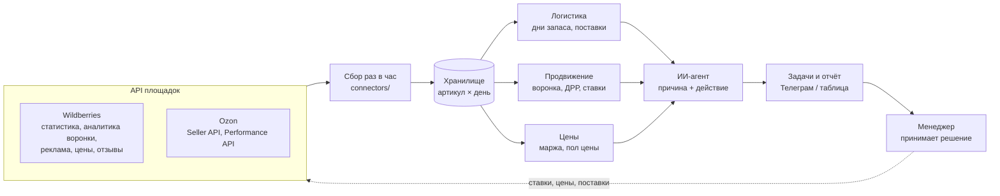

# Агенты для маркетплейсов: логистика, продвижение, цены

Скелет системы для бренда с собственным производством, который продаёт на Wildberries и Ozon.
Три направления: **логистика**, **продвижение**, **ценообразование**. Данные забираем из API площадок,
правила считают цифры, ИИ-агент объясняет отклонения и предлагает действие. Решение принимает человек.

Сделано на основе того, что уже работает у меня в e-commerce (комплектующие, Ozon / WB / Яндекс Маркет):
выгрузка API в таблицы, агент по поставкам, агент по ДРР и конверсии, триггеры по отзывам.

```bash
python3 -m mp demo        # прогон на демо-данных, отчёт в demo/report.md
```

Демо-данные в `demo/` выдуманы для примера и не относятся к реальным товарам.

---

## Схема



## 1. Логистика

| Что считаем | Правило | Действие |
|---|---|---|
| Дни запаса по складу | остаток / средние продажи за 14 дней | меньше 14 дней → поставка, больше 60 → платное хранение под угрозой |
| Объём поставки | продажи × (срок поставки + 30 дней) − остаток − в пути | черновик поставки по складам |
| Платное хранение | артикулы с запасом больше 60 дней | снизить поставки, акция или перераспределение |
| Out of stock | 0 на складе при живой рекламе | остановить кампанию, иначе бюджет уходит впустую |

Агент собирает поставку, оператор проверяет и нажимает последнюю кнопку.

## 2. Продвижение

| Что считаем | Правило | Действие |
|---|---|---|
| ДРР по артикулу и кампании | расход / выручка с рекламы | выше нормы → снизить ставку или остановить |
| Воронка | показы → клики → корзина → заказ → выкуп | агент показывает, на каком шаге провал |
| CTR ниже среднего по категории | проблема в фото / цене на выдаче | задача на контент |
| Корзина → заказ падает | цена, отзывы, доставка | задача на цену или логистику |
| Рейтинг артикула просел | триггер по отзывам | не гнать рекламу в эту карточку, разобрать отзывы |
| Поисковые запросы | ИИ кластеризует запросы | SEO для карточек, минус-слова для кампаний |

## 3. Ценообразование

| Что считаем | Правило | Действие |
|---|---|---|
| Пол цены | себестоимость + комиссия + логистика + реклама + целевая маржа | цену ниже пола агент не предлагает |
| Юнит-экономика | прибыль на единицу по каждой площадке | отрицательная → сигнал |
| Цена против конкурентов | разница с медианой по аналогам | предложить изменение в рамках коридора |
| Эластичность | заказы до и после изменения цены | понять, где снижение цены окупается |

Для производителя себестоимость известна точно, поэтому пол цены считается надёжно.

## Где ИИ, а где правила

- **Правила** считают цифры: ДРР, дни запаса, маржу. Тут ИИ не нужен, нужна точность.
- **ИИ-агент** читает результат и пишет по-человечески: что случилось, почему, что сделать. Разбирает отзывы и поисковые запросы.
- **Человек** утверждает ставки, цены и поставки. Агент сам деньги не тратит.

## Структура

```
mp/
  connectors/   wb.py, ozon.py — забор данных из API (ключи в .env)
  modules/      logistics.py, ads.py, pricing.py — правила
  agent.py      ИИ-слой: объяснение и задачи
  report.py     отчёт в markdown / Телеграм
config.example.yaml   нормы ДРР, сроки поставки, маржа
demo/                 демо-данные и пример отчёта
```

## План внедрения

1. **Неделя 1–2.** Подключить API, выгрузка по артикулам в одну таблицу, проверить цифры с кабинетами.
2. **Неделя 3–4.** Включить правила по ДРР и остаткам, ежедневный отчёт.
3. **Месяц 2.** ИИ-агент: причины по воронке, отзывы, поисковые запросы.
4. **Месяц 3.** Черновики поставок и предложения по ценам на утверждение.
