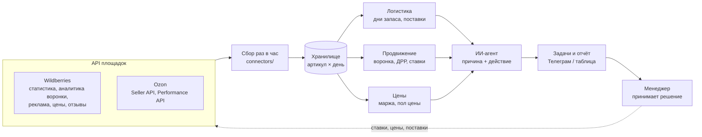

# Агенты для маркетплейсов: логистика, продвижение, цены

Скелет системы для бренда с собственным производством, который продаёт на Wildberries и Ozon.
Три направления: **логистика**, **продвижение**, **ценообразование**. Данные забираем из API площадок,
правила считают цифры, ИИ-агент объясняет отклонения и предлагает действие. Решение принимает человек.

Подход я обкатала в e-commerce на реальных кабинетах. Этот репозиторий — отдельный учебный проект без данных
компаний: каждый бизнес настраивает правила под себя.

```bash
python3 -m mp demo        # прогон на демо-данных, отчёт в demo/report.md
```

Демо-данные в `demo/` выдуманы для примера и не относятся к реальным товарам.

---

## Схема



## 1. Логистика

| Что считаем | Правило | Действие |
|---|---|---|
| Дни запаса по складу | остаток / средние продажи за 14 дней | меньше 14 дней → поставка, больше 60 → платное хранение под угрозой |
| Объём поставки | продажи × (срок поставки + 30 дней) − остаток − в пути | черновик поставки по складам |
| Платное хранение | артикулы с запасом больше 60 дней | снизить поставки, акция или перераспределение |
| Out of stock | 0 на складе при живой рекламе | остановить кампанию, иначе бюджет уходит впустую |

Агент собирает поставку, оператор проверяет и нажимает последнюю кнопку.

## 2. Продвижение

| Что считаем | Правило | Действие |
|---|---|---|
| ДРР по артикулу и кампании | расход / выручка с рекламы | выше нормы → снизить ставку или остановить |
| Воронка | показы → клики → корзина → заказ → выкуп | агент показывает, на каком шаге провал |
| CTR ниже среднего по категории | проблема в фото / цене на выдаче | задача на контент |
| Корзина → заказ падает | цена, отзывы, доставка | задача на цену или логистику |
| Рейтинг артикула просел | триггер по отзывам | не гнать рекламу в эту карточку, разобрать отзывы |
| Поисковые запросы | ИИ кластеризует запросы | SEO для карточек, минус-слова для кампаний |

## 3. Ценообразование

| Что считаем | Правило | Действие |
|---|---|---|
| Пол цены | себестоимость + комиссия + логистика + реклама + целевая маржа | цену ниже пола агент не предлагает |
| Юнит-экономика | прибыль на единицу по каждой площадке | отрицательная → сигнал |
| Акция площадки | прибыль на единицу по цене акции | плюс → заходить, минус → не заходить |
| Конкурент дешевле | цена конкурента против нашего пола | снижаем до пола, ниже — держим цену и работаем с карточкой |
| Мало запаса | меньше 7 дней до нуля | поднять цену на 5–10%, чтобы хит не ушёл в ноль до поставки |
| Много запаса | больше 90 дней | снизить цену в пределах пола вместо платного хранения |
| Эластичность | заказы до и после изменения цены | понять, где снижение цены окупается |

Для производителя себестоимость известна точно, поэтому пол цены считается надёжно.

### Модельные кейсы (из демо-отчёта)

- **Акция с убытком.** Площадка зовёт шампунь в акцию по 199 ₽. При этой цене минус 17 ₽ с каждой продажи → не заходим.
- **Акция в плюс.** Гель для душа по цене акции 229 ₽ даёт +35 ₽ с единицы → заходим.
- **Конкурент демпингует.** Конкурент 239 ₽, наш пол 251 ₽ → снижаем только до 251 ₽, дальше работаем с карточкой.
- **Хит заканчивается.** Крема на 6 дней, поставка через 7 → поднимаем цену, чтобы не обнулиться и не потерять позиции.
- **Залежалый товар.** Маски на 160 дней → снижаем цену на 10% вместо оплаты хранения.

## Чем это отличается от готовых сервисов

На рынке есть отдельные инструменты: биддеры держат позицию рекламы, репрайсеры двигают цену за конкурентом,
сервисы поставок считают отгрузки. Каждый оптимизирует своё и не видит соседей.
Здесь три направления связаны в одну логику:

- нет остатка → реклама останавливается;
- рейтинг просел → реклама в карточку не идёт;
- запаса мало → цена не идёт вниз за конкурентом;
- цена не опускается ниже пола, даже если этого требует акция или конкурент.

Готовые биддеры и репрайсеры можно подключить как исполнителей, а правила и решения остаются у бренда.

## Где ИИ, а где правила

- **Правила** считают цифры: ДРР, дни запаса, маржу. Тут ИИ не нужен, нужна точность.
- **ИИ-агент** читает результат и пишет по-человечески: что случилось, почему, что сделать. Разбирает отзывы и поисковые запросы.
- **Человек** утверждает ставки, цены и поставки. Агент сам деньги не тратит.

## Структура

```
mp/
  connectors/   wb.py, ozon.py — забор данных из API (ключи в .env)
  modules/      logistics.py, ads.py, pricing.py — правила
  agent.py      ИИ-слой: объяснение и задачи
  report.py     отчёт в markdown / Телеграм
config.example.yaml   нормы ДРР, сроки поставки, маржа
demo/                 демо-данные и пример отчёта
```

## План внедрения

1. **Неделя 1–2.** Подключить API, выгрузка по артикулам в одну таблицу, проверить цифры с кабинетами.
2. **Неделя 3–4.** Включить правила по ДРР и остаткам, ежедневный отчёт.
3. **Месяц 2.** ИИ-агент: причины по воронке, отзывы, поисковые запросы.
4. **Месяц 3.** Черновики поставок и предложения по ценам на утверждение.
